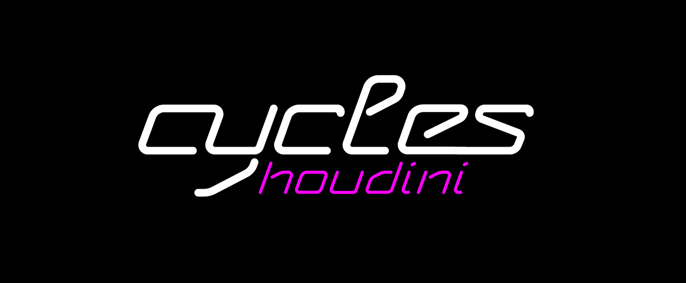
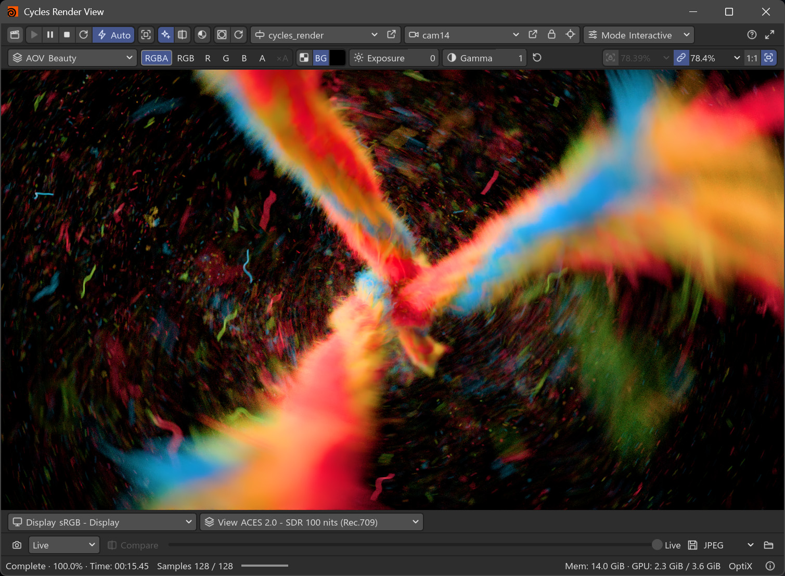
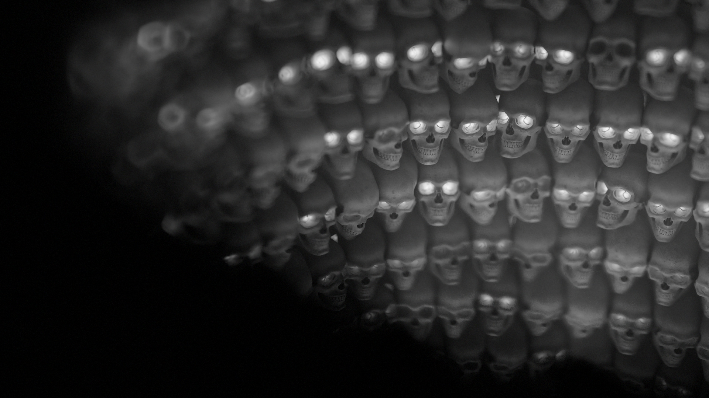
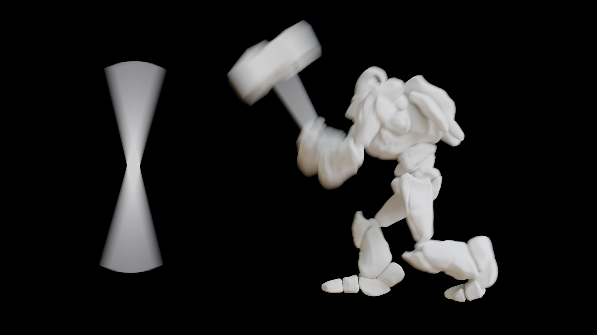
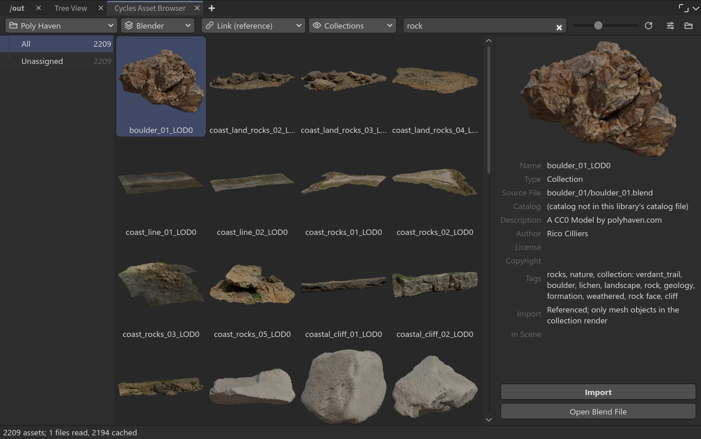

# Cycles for Houdini

An open-source integration of Blender's Cycles rendering engine into Houdini, bringing a free and familiar alternative to the Houdini rendering ecosystem.

Cycles for Houdini is an independent community project, unaffiliated with SideFX or the Blender Foundation.

## Q&A

**Is this vibe-coded?**

Yes. Over the years, there have been several attempts to integrate Cycles into Houdini, but none have resulted in a widely adopted, practical rendering solution.

Without a financial incentive, few developers are willing to undertake a project of this scale, let alone maintain it over the years. This makes it a particularly good candidate for AI-assisted development.

As a Houdini artist, I would love to have another rendering engine at my disposal, especially one that is free, open-source and already familiar to many artists.

Of course, none of this would be possible without the tremendous work of the Cycles developers. This project builds upon their achievements and in no way diminishes the value of their work.

**What about maintanance and support?**

We live in a different technological landscape now. AI-assisted development makes maintaining, extending and adapting software increasingly accessible, even to people without an extensive programming background.

Rather than distributing precompiled installers for specific Houdini versions, the project provides an automated build system that allows you to compile and package the renderer for your installed Houdini 22.0 builds, whether they are production or daily releases.

During testing, I successfully built installers for three different Houdini versions in a single run. While future Houdini updates may introduce compatibility issues, the source code and build infrastructure are available for anyone to investigate and resolve them.

There is no guaranteed long-term maintenance or dedicated technical support. However, you are encouraged to use your preferred AI coding assistant to troubleshoot issues, implement missing features or adapt the integration to your own workflow.

**Where can I get it?**

You can build it yourself. No programming knowledge is required.

1. Download and extract this repository.

2. Run `START HERE - Build Cycles for Houdini.cmd`.

3. Follow the instructions to download the required dependencies and build the renderer.

4. Once the build is complete, run the generated installer for your Houdini version.

The process is largely automated, including dependency management, compilation, testing and installer generation.
Currently, the integration targets Houdini 22.0 on Windows.

**Does this work in Solaris?**

No. This integration focuses on the traditional OBJ/SOP workflow, with an approach similar to the classic Redshift integration. I am aware of SideFX's increasing emphasis on Solaris and USD-based workflows. However, many Houdini artists, myself included, still appreciate the simplicity, flexibility and directness of the traditional workflow. There are other projects exploring Cycles integration through Solaris. That is simply not the primary focus of this project. Being open-source, nothing prevents someone from extending the integration in that direction.

**Is it production-ready?**

Probably not. Not yet, anyway. I have tested the renderer across a variety of scenes, features and rendering scenarios, but there will inevitably be bugs, missing functionality, performance bottlenecks and situations I have not encountered. This is precisely where the community can make a difference. Test it, break it, report issues, improve it, experiment with new features or adapt it to your specific needs. If you have a strong technical background, great. If you don't, that is no longer necessarily a barrier to contributing. AI-assisted development is here to stay. We might as well explore what it enables us to build.

**Additional Features**

Beyond bringing Cycles into Houdini, this project also explores additional rendering capabilities and extensions to the existing feature set.

[Dielectrics](docs/user/nested-dielectrics.md)

[Image Iris](docs/user/image-iris.md)

[Acceleration blur](docs/user/native-object-properties.md)

[Resampled Light Sampling](docs/user/resampled-light-sampling.md)

Enable selective resampling to reduce direct-lighting noise in some scenes.

[Focus pulls and zoom blur](docs/user/focus-pulls-and-zoom-blur.md)

Animate focus distance and focal length. Cycles samples the camera optics across the shutter for each frame.

[Gaussian splats](docs/user/gaussian-splats.md)

Render Houdini points with 3DGS or GSplats attributes as native Gaussian splats on CPU or OptiX.

[Convert Houdini materials](docs/user/convert-materials.md)

Convert Principled Shader, MaterialX Standard Surface and OpenPBR Surface to editable Cycles materials. The conversion report flags approximations and omissions.

[Live COP textures](docs/dev/notes/native-cop-images.md)

Use `op:` paths to feed live COPernicus or legacy COP images into material and environment textures.

[Scatter animated Blender assets](docs/user/point-instancing.md)

Scatter animated `.blend` objects or collections on Houdini points, with a separate source frame per point.

[Compositing passes](docs/user/native-passes.md)

Save light groups and Cryptomatte alongside the beauty pass in a multilayer EXR.

**Asset Browser**

Import Blender assets directly into Houdini.

## More info

Render Houdini OBJ/SOP scenes with Blender's Cycles path tracer. Use the **Cycles Render** Python Panel for
interactive rendering and the **Cycles Render** output node for final renders to disk. Render on the CPU or an
NVIDIA GPU with OptiX.

The project is in early development and ships as source. Build your own installer for Houdini 22.0 (Indie, Core or FX)
on Windows x64. Solaris and deep image output are unsupported.

[Build and install](#get-it) | [Make your first render](#make-your-first-render) | [Artist guides](docs/user/README.md) | [Development credits](#development-credits)

Cycles supports native materials, lights and world shaders, curves, packed instances, Gaussian splats, and optional
NVIDIA DLSS Ray Reconstruction in the interactive viewer. The optional Blender bridge imports or renders objects,
collections and materials from `.blend` files and Blender asset libraries. [Blender asset browser guide](docs/user/asset-browser.md)

## Get it

There is no ready-made installer to download. You build Cycles for Houdini on your own computer, for the Houdini
you have, by double-clicking one file. It asks before installing missing tools or downloading NVIDIA parts, builds, tests and
makes an installer (Setup) for each of your Houdini builds. The build itself installs nothing into Houdini: you
install Cycles by double-clicking an installer.

You need:

- **Windows 10 or 11**, 64-bit.
- **Houdini 22.0** (Indie, Core or FX; not Apprentice) **with its development kit** ticked when you install Houdini.
  It builds for the 22.0 builds you have; 22.0.466 is the one this project was tested with (22.0.429 and 22.0.508 were
  also built and quick-tested). With several 22.0 builds installed it builds for those without Cycles, or for the
  ones you choose.
- **Disk space and time**: about 3.3 GB for one Houdini build (about 1.6 GB more for each further one) and about 13 minutes for the first Houdini build and about 5 minutes for each further one on a fast computer, installers included (the GPU programs are made once and reused; measured on a Ryzen 9 7950X: 22.7 minutes for three), plus the time to install the tools if they are missing.
- **An NVIDIA graphics card is optional.** GPU rendering and GPU denoising need an NVIDIA graphics card with its
  driver installed. Installing or updating the driver is up to you. Without an NVIDIA card, or if you decline the NVIDIA downloads, your build renders on the CPU.

Then:

1. On this page, click **Code**, then **Download ZIP**, and unpack it into a short folder such as `D:\Cycles`.
2. Double-click **`START HERE - Build Cycles for Houdini.cmd`** in that folder.
3. Choose whether to allow NVIDIA downloads for GPU rendering and whether to install any missing tools.
   If several Houdini builds are installed, choose which ones to build for. At the end it shows where
   your installers are (one per Houdini build, in the `Installers` folder inside the project folder). Build output
   stays in `Installers` and `_work`. Installed Cycles files are in the separate location you choose in Setup.
4. Double-click the installer for your Houdini build. Uninstall it in Windows **Settings > Apps > Installed apps**.
   See [which files uninstall keeps](docs/user/build-it-yourself.md#uninstall-cycles) before removing saved data.

Step by step, with what you will see: [Build it yourself](docs/user/build-it-yourself.md). Later, the same file
updates, rebuilds and makes new installers (for example after a new Houdini daily build).

## Make your first render

1. Start Houdini and set up a lit sphere with a camera aimed at it.
2. On the **Cycles Tools** shelf, click **Render ROP** to add a **Cycles Render** output node.
3. Set the node's device to **CPU**, then click **IPR** to open the **Cycles Render** viewer.
4. Select the ROP and camera in the viewer, then click **Play** to start the interactive render.

## More

| You want to                                           | Read                                                                                                 |
| ----------------------------------------------------- | ---------------------------------------------------------------------------------------------------- |
| Build and run your own copy without writing code      | [Build it yourself](docs/user/build-it-yourself.md)                                                  |
| Give your installer to someone else                   | [Build it yourself, Part 2](docs/user/build-it-yourself.md#part-2-give-an-installer-to-someone-else) |
| Work on the code: repository map, build, tests, rules | [Developer guide](docs/dev/README.md)                                                                |
| Understand how the parts fit together                 | [Architecture overview](docs/dev/architecture-overview.md)                                           |
| Report a problem or propose a change                  | [CONTRIBUTING.md](CONTRIBUTING.md)                                                                   |
| Build from the command line                           | [Building from source](docs/dev/building-from-source.md)                                             |
| Use the renderer in Houdini                           | [Artist guides](docs/user/README.md)                                                                 |
| NVIDIA parts and their licences                       | [NVIDIA parts and their licences](docs/dev/nvidia-licences.md)                                       |

## Status

Early development. Expect missing features, rough edges and changes between revisions. The project is published
as source only, with no official installer.

## Development credits

Karlis Stigis + Claude (Anthropic) & Codex (OpenAI).

## Supported Houdini builds

The builder targets installed Houdini 22.0 builds with their development kits on Windows x64. It builds for each
chosen version. Matching HDK ABI and libraries also allow some builds to load the same plugin
([decision 0008](docs/decisions/0008-houdini-build-compatibility.md)). Houdini Apprentice is unsupported.

## What has been tested, and on what

| Houdini Indie build | Coverage                                                            |
| ------------------- | ------------------------------------------------------------------- |
| 22.0.466            | Development and release tests, builder quick tests and hands-on use |
| 22.0.508            | Builder quick tests and hands-on use with a self-built installer    |
| 22.0.429            | Builder quick tests                                                 |

- The builder's quick-test results came from one Windows 11 computer with a GeForce RTX 4090 and RTX 3080 Ti.
  It ran CPU and OptiX renders. A physical machine without NVIDIA hardware has yet to be tested.
- Houdini Core and FX are build targets. Creating Cycles Light and Blender File nodes and reopening scenes with them
  in those editions remains unverified.
- Blender bridge reference data came from Blender 5.2.0 LTS and 5.3 builds. Other versions are untested.

## Known issues

- **GPU fault on a heavy scene (open).** On one heavy production scene, a 4K final render on both GPUs at once stopped with CUDA "illegal address" errors while both cards were close to full memory. The cause is not established. The error shown to the artist currently names an illegal memory access; if the fault turns out to depend on memory, that message points the wrong way. Not yet tested: whether the same frame renders on a single GPU or at a lower resolution.
- See the [coverage table](#what-has-been-tested-and-on-what) for the Houdini builds and editions exercised.

## Licences

The Houdini integration and most project tooling use the [Apache License 2.0](LICENSE). The shipped
[Blender component](blender/) and six source-only Blender fixture generators in scripts/ use the
[GNU General Public License version 3 or later](blender/LICENSE). The Houdini integration starts the component
in a separate Blender process and exchanges files, command-line arguments and pipe messages with it. Source files
carry SPDX licence identifiers. Third-party components keep their own licences, including the Blender-derived shelf
and installer icons under the GNU GPL. [THIRD_PARTY_NOTICES.md](THIRD_PARTY_NOTICES.md) lists the generators and
records the licences, code attribution and the separate review of the Blender compatibility rewrites.

**Giving your installer to someone else.** The installers that `START HERE - Build Cycles for Houdini.cmd` makes are for your own use; they can also be given to others ([Build it yourself, Part 2](docs/user/build-it-yourself.md#part-2-give-an-installer-to-someone-else)), but what they may legally contain is the responsibility of whoever gives them away. This is a description, not legal advice.

- It contains code compiled from NVIDIA's OptiX headers, GPU programs made with NVIDIA's CUDA compiler and, with DLSS on (the default), NVIDIA's DLSS loader: NVIDIA's licence terms apply to sharing them ([docs/dev/nvidia-licences.md](docs/dev/nvidia-licences.md); [THIRD_PARTY_NOTICES.md](THIRD_PARTY_NOTICES.md), the two NVIDIA rows). The first run's list names these parts.
- Most shelf icons and the installer icon are Blender icons under the GNU GPL, version 2 or later (THIRD_PARTY_NOTICES.md section 3); their notices go into every installer. The installer step reports the package's own licence-notice check.
- An installer you build is not signed, so Windows shows "Windows protected your PC" when someone opens it; they choose "More info", then "Run anyway". Only share installers with people who trust you.
- Setup requires the Houdini 22.0 build it was made for. Its package can also load in an installed build with the
  same HDK API and required libraries. Apprentice, macOS and Linux are unsupported.
- A community installer shows your name and build identity in Setup and Windows Settings > Apps. If two Cycles
  packages can load in the same Houdini build using the same preferences, Setup asks you to uninstall the other
  Cycles build first.

## NVIDIA OptiX and DLSS

With an NVIDIA graphics card, the builder asks before downloading the listed CUDA compiler parts and OptiX or DLSS SDK headers. Decline to build for the CPU. NVIDIA's files remain under their own licences, which the person who builds accepts ([docs/dev/nvidia-licences.md](docs/dev/nvidia-licences.md), [THIRD_PARTY_NOTICES.md](THIRD_PARTY_NOTICES.md)). DLSS is optional: it is used only for the interactive viewer and can be left out with the menu item "Turn DLSS off" (`"dlss": "off"` in `build-identity.json`; on the command line, the CMake option `CH_DLSS=OFF`). NVIDIA, OptiX, DLSS, RTX and CUDA are trademarks of NVIDIA Corporation; this project is not affiliated with or endorsed by NVIDIA.

`patches/0077-houdini-dlss-project.patch` records this project's NGX identifier. The builder generates a random GUID
for a community build using the default DLSS setting and saves it in `build-identity.json`. CMake compiles it in via
`CH_DLSS_PROJECT_ID`. The default community mode rejects the project's identifier. Follow the
[build identity guide](docs/dev/community-builds.md#build-identityjson-who-made-this-build) when updating your build
or distributing a fork.

## Build from source

Step by step without code: [docs/user/build-it-yourself.md](docs/user/build-it-yourself.md). From the command line:
[docs/dev/building-from-source.md](docs/dev/building-from-source.md).

## Tests

The test scripts live in `tests/`; `tests/test-catalogue.json` lists which runner each one belongs to and what it needs, and [tests/TESTING.md](tests/TESTING.md) explains the runners. What to expect on a machine other than the developer's:

| Group                                      | How to run                                                                       | Needs                                                                                                                                                                                                                                                                               | Expected on a fresh machine                                                                 |
| ------------------------------------------ | -------------------------------------------------------------------------------- | ----------------------------------------------------------------------------------------------------------------------------------------------------------------------------------------------------------------------------------------------------------------------------------- | ------------------------------------------------------------------------------------------- |
| Pure contract tests (pytest marker `pure`) | `python -m pytest -c tests/pytest.ini tests/pytest_cases -m pure`                | Windows, Python 3.12 or newer, Git for temporary repository fixtures, PowerShell 7, the pinned test packages (`./scripts/bootstrap-test-deps.ps1 -Download`), `houdini/python3.13libs` on `PYTHONPATH`. No Houdini, GPU or Blender. Tests that need PySide6 are skipped without it. | Should pass. Not yet confirmed on a second machine.                                         |
| `fast` tier                                | `./scripts/run-tests.ps1 -Tier fast -BuildDirectory <build> -Artifacts <folder>` | A completed build (including its toolchain: Visual Studio C++ compiler and CMake) and a licensed Houdini 22.0.466 (`hython`). CPU only; no GPU and no Blender.                                                                                                                      | Should pass after a successful build. Not yet confirmed on a second machine.                |
| `nightly` tier (several hours)             | `./scripts/run-tests.ps1 -Tier nightly ...`                                      | Everything above, plus an NVIDIA OptiX GPU and a Blender executable (`CYCLES_HOUDINI_BLENDER`).                                                                                                                                                                                     | Needs the extra hardware and software; image comparisons were made on the developer's GPUs. |
| Workstation-specific checks                | `-Tests <name>` with exact GPU ids                                               | Two CUDA/OptiX GPUs, or an RTX 4090 with matching Windows GPU counters; excluded from the portable nightly with a reason in the catalogue.                                                                                                                                          | Not expected to run elsewhere without the same hardware.                                    |
| GUI, manual and benchmark scripts          | see `tests/TESTING.md`                                                           | An interactive Houdini session; some need Blender. A few refer to private scenes that are not in the repository.                                                                                                                                                                    | Not part of an automatic pass.                                                              |

Use `./scripts/run-tests.ps1 -Tier fast -ListTests` to list the current fast tier. Select `nightly` in the same
command to list that tier. The test catalogue describes each case and its requirements. The full pure suite has been tested in a Git
checkout. For an unpacked archive, see the [standalone document and encoding checks](docs/dev/README.md#checking-a-source-zip).
