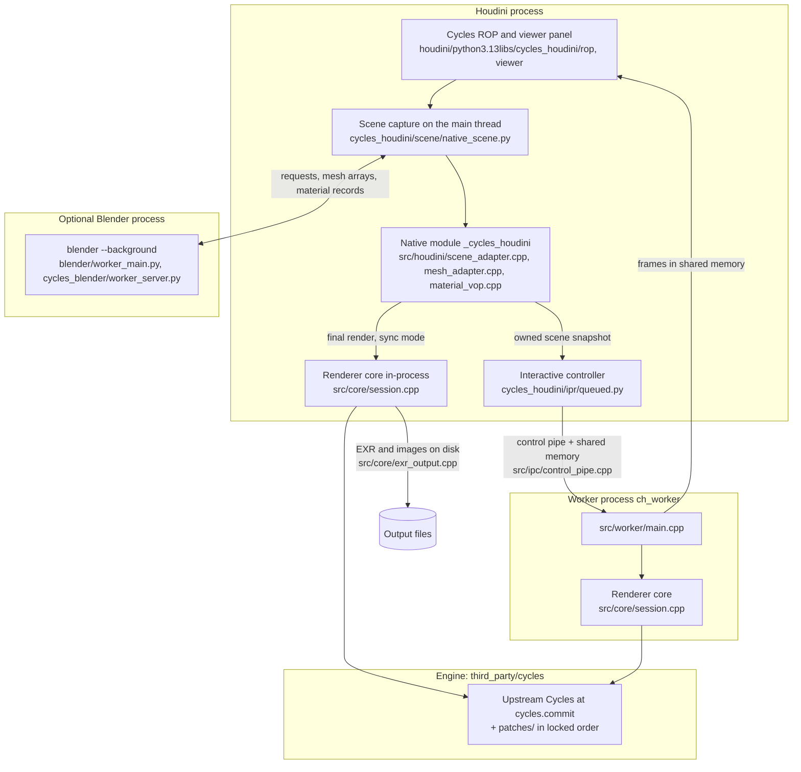

# Architecture overview

A one-page map of how a Houdini scene becomes pixels. Every box names the files that implement it. For thread
ownership, lock order, cancellation and recovery, read the detailed [renderer architecture](renderer-architecture.md).

## Processes

| Process | Started by | Role |
| --- | --- | --- |
| Houdini (GUI or `hython`) | the artist | Runs the Python package `houdini/python3.13libs/cycles_houdini/` and loads the native module `_cycles_houdini` (built from `src/houdini/` and `src/core/`, target in `src/CMakeLists.txt`). |
| `ch_worker` | `cycles_houdini/ipr/queued.py` (starts `bin/ch_worker.exe` of the selected build) | Owns the Cycles session and device for interactive rendering and material previews (`cycles_houdini/materials/material_previews.py`). Talks to Houdini over a binary control pipe on stdin/stdout; bulk data uses acknowledged shared-memory mappings (`include/cycles_houdini/ipc/control_pipe.h`, `include/cycles_houdini/ipc/shared_memory.h`). |
| Background `hython` | `cycles_houdini/rop/background_render.py` | Renders a saved snapshot of the scene in a separate Houdini batch process while the artist keeps working. |
| Blender (optional) | `cycles_houdini/blender/blend_worker.py` | A separately installed Blender started with `--background --factory-startup`. It reads `.blend` files and sends numeric arrays and material descriptions back. |

Final renders from the ROP go through SOHO (`houdini/soho/CHRender.py` calls `cycles_houdini/rop/soho_adapter.py`)
and run in Houdini's own process by default: `cycles_houdini/core/execution.py` selects `sync` unless
`CYCLES_HOUDINI_EXECUTION=worker` is set. Frames are rendered in order (`cycles_houdini/rop/final_render.py`).

## From a Houdini scene to pixels

1. **Read the scene.** On Houdini's main thread, `cycles_houdini/scene/native_scene.py` evaluates ROP parameters,
   cooks SOPs and resolves materials, lights and the world.
2. **Convert.** The native module turns geometry (`src/houdini/mesh_adapter.cpp`, `point_curve_adapter.cpp`,
   `volume_adapter.cpp`, `packed_adapter.cpp`) and material networks (`src/houdini/material_vop.cpp`,
   `material_subnet.cpp`) into owned values: plain arrays and shader graphs that no longer point into Houdini. The
   value contract is `include/cycles_houdini/session.h` and `include/cycles_houdini/snapshot.h`.
3. **Send.** For the viewer, `cycles_houdini/ipr/queued.py` serialises the snapshot (`src/core/snapshot_wire.cpp`)
   and sends it to `ch_worker`. It tracks which version the worker has acknowledged and drops outdated work.
4. **Render.** `src/core/session.cpp` (`RenderSession`) checks the update, applies it to the Cycles scene and lets
   Cycles render on the CPU or with OptiX (`src/core/render_devices.cpp`).
5. **Show or save.** The worker publishes frames into shared memory; the viewer (`cycles_houdini/viewer/`) displays
   the newest matching frame. Final renders write image files (`src/core/exr_output.cpp`, `src/core/image.cpp`).

## Where the engine patches fit

The engine in `third_party/cycles` is not edited by hand and is not stored in this repository.
`scripts/bootstrap.ps1` downloads upstream Cycles at `cycles.commit` from `source.lock.json`, applies every file in
`patches/` in the order of `cycles.patches`, and checks the result against `cycles.authoring_tree`
(`scripts/engine-fork.py`, `scripts/engine_source.py`). The first patch,
`patches/0001-integration-build-hook.patch`, attaches this project's targets to the engine's own CMake build; the
others change engine behaviour (for example persistent scene updates, subdivision limits, texture revisions).
`patches/inventory.json` records each patch's purpose, the engine files it touches and the tests that cover it;
[docs/upstream-patches.md](../upstream-patches.md) explains the early ones.

## What the Blender bridge does

The bridge lets an artist use objects, collections, materials and worlds from `.blend` files and Blender asset
libraries. Houdini never loads Blender code: `cycles_houdini/core/blender_bridge.py` finds a Blender executable
(or `CYCLES_HOUDINI_BLENDER`), and `cycles_houdini/blender/blend_worker.py` starts it as a reusable background
process. The scripts that run inside Blender (`blender/cycles_blender/blend_export.py`,
`blend_material_export.py`, `blend_world_export.py`; a separate GPL-3.0-or-later component) evaluate the requested objects at the requested frames and
return mesh arrays and material records over a private pipe. On the Houdini side, `src/houdini/blend_mesh.cpp`
turns the arrays into native meshes and the material records become Cycles shader graphs. Guides:
[docs/user/blender-import.md](../user/blender-import.md), [docs/user/asset-browser.md](../user/asset-browser.md).

## Build pieces

`CMakeLists.txt` and `src/CMakeLists.txt` define the targets: `ch_core` (renderer core), `_cycles_houdini` (the
Houdini module), `ch_worker`, `ch_ipc`, `ch_harness` and the contract executables. `scripts/build.ps1` builds the
default targets `cycles`, `ch_harness`, `_cycles_houdini` and `ch_worker`, and `scripts/stage-development.ps1`
assembles a Houdini package from them in the build folder.
