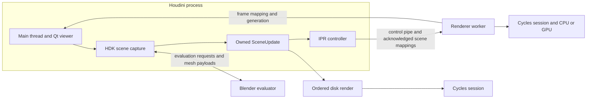

# Native OBJ/SOP renderer architecture

The Cycles ROP in Houdini 22.0.466 uses the same scene representation for interactive, disk and background renders. The renderer boundary is the C++ value contract in [session.h](../../include/cycles_houdini/session.h). Mesh arrays, shader graphs, camera settings and object updates crossing this boundary have explicit ownership. HDK nodes and Blender data-block pointers stay in their respective hosts.

| Owner | Work and handoff |
| --- | --- |
| Houdini main thread | Evaluates parameters, cooks SOPs, obtains safe retained geometry, resolves materials, and schedules capture through [native_scene.py](../../houdini/python3.13libs/cycles_houdini/scene/native_scene.py). Qt owns widget updates on this thread. |
| Capture and preparation threads | Convert supported retained data into native values. Prepare immutable desired snapshots, including sparse pose updates. Host-only lookups and callbacks resume on the Houdini thread. |
| IPR controller | [queued.py](../../houdini/python3.13libs/cycles_houdini/ipr/queued.py) schedules submissions, tracks which snapshot the worker acknowledged, prioritizes camera and stop events, and publishes matching frames to the viewer. |
| Renderer process | [ch_worker](../../src/worker/main.cpp) receives control messages and owns the Cycles session and device. The wire codec and shared-memory regions carry scene and frame payloads. Both sides retain mapped data until its consumer has acknowledged ownership. |
| Optional Blender process | Evaluates referenced objects and collections at selected frames. Numeric arrays travel over its private pipe to the Houdini adapter, which creates native meshes and resolves supported shaders. This process can be reused across frame and seed edits. [Blender instancing contract](../user/point-instancing.md) |
| Final and background renders | Ordered final frames use the shared core and can retain scene data across frames. Background rendering starts a separate Houdini batch process with the submitted package identity. [Final render execution](../user/native-background-final.md) |

## Scene updates, cancellation and color

A submission identifies a desired generation. The adapter owns its prepared data until promotion or discard. A late preparation result must still match its generation and scene roots before publication. A viewer frame also carries its physical revision so a preview cannot replace a newer committed image. [Capture ownership](notes/native-async-capture.md) · [IPR execution](notes/native-execution-policy.md)

`RenderSession::apply` validates the candidate before entering its engine mutation callback. A pre-mutation rejection lets the last accepted scene continue. A failure once mutation starts is a renderer failure and follows the recovery path. Persistent updates run the callback at a synchronized engine boundary. The controller can discard stale queued work while an earlier operation completes. The worker, exporter, and GUI have different lifetimes. Closing one must release only the work and handles it owns. [Session implementation](../../src/core/session.cpp) · [Worker recovery](notes/native-worker-prototype.md)

Each render worker owns its Cycles and OCIO state. When its render policy changes, it joins its own render before loading the next configuration. Published frames retain the color configuration used to render them. Explicit in-process sessions share stock Cycles state and must use compatible policies while their lifetimes overlap. Their admission lock protects policy identities only. Session control precedes frame-store locking. [Session implementation](../../src/core/session.cpp) · [Color management](notes/native-color.md)

## Verifying a change

The root lock, ordered engine patches, tested manifest and release snapshot identify a build. Use the installed release ID to identify the package selected by Houdini. The source Git tag and the upstream Cycles revision identify different trees.

- Run `./scripts/run-tests.ps1 -Tier fast` for CPU snapshot, status, rejection, cache and release contracts. Use `-ListTests` with a tier to see the selected cases and their evidence. The extended compatibility tier adds color changes, camera navigation, real worker failure and viewer lifecycle. It launches background Blender to render reference images of a textured object and collection at two animation frames, then compares them with Houdini on CPU and OptiX. Set `CYCLES_HOUDINI_BLENDER` for an installation outside the adapter's normal discovery paths.
- Run the GUI portion on its own desktop or schedule it separately from other GUI qualification. The worker-failure fixture checks that the renderer is actively tracing when it is killed. The native Render View can send a pause request to the shared worker. A paused precondition needs investigation before counting that case as a pass.
- `launchers/Build and make installer.cmd` drives the isolated build, render qualification and installer packaging. Image Iris must render in both staged and installed runtimes. DLSS Ray Reconstruction in IPR, Gaussian splats and the ordered fixes are production requirements. [Release workflow](release-workflow.md)
- For a latency report, time Houdini capture and edit-to-first-image independently. Keep instrumented phase samples separate from the uninstrumented A/B. Record the package, device, source scene, samples, repetitions and edit. 28f9f480 benchmark (`artifacts/blend-speed-466/final/timings.md`)
